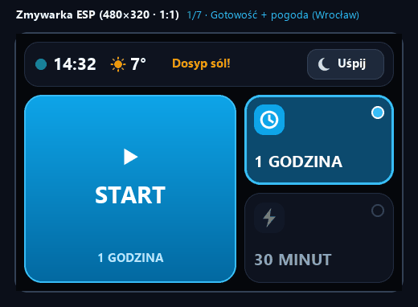
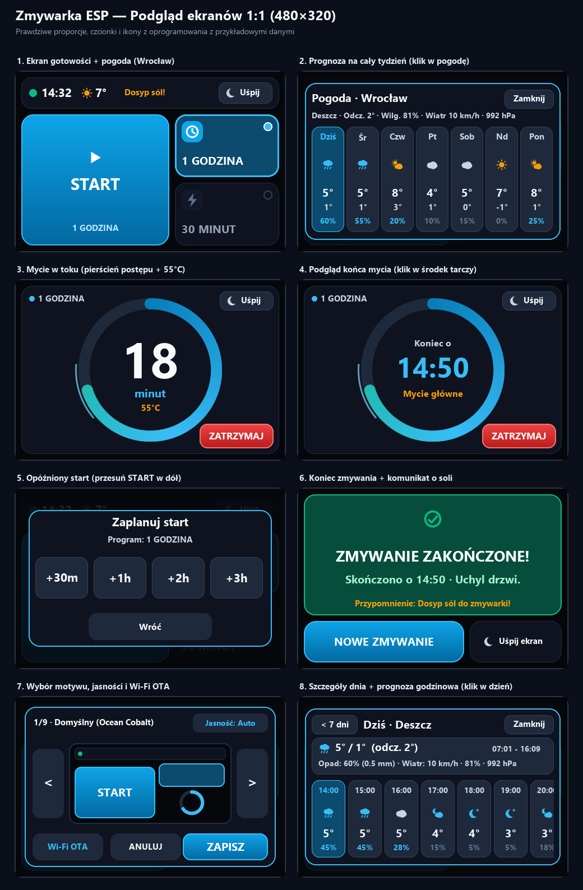
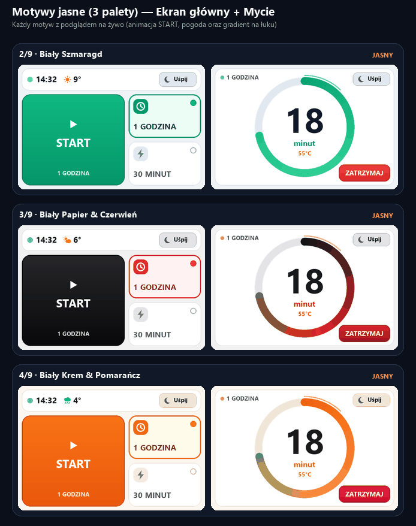
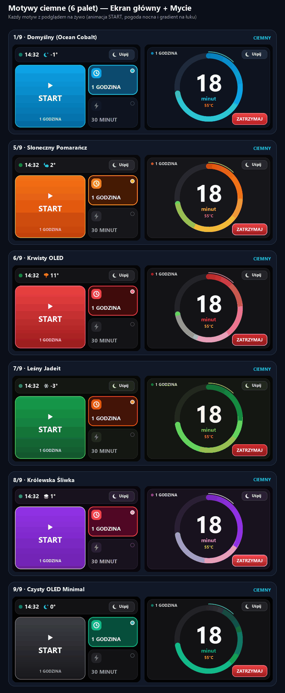

# Zmywarka ESP (`JC3248W535EN`)

Lokalny panel dotykowy do zmywarki **Midea** (protokół V3) postawiony na płytce **ESP32-S3** z ekranem `480×320`. Działa bezpośrednio po domowym Wi-Fi, bez chmury, konta producenta i Home Assistanta. Całość napisana w **ESP-IDF 5.2.1** + **LVGL 8.4** (PlatformIO).

- **Jak to działa od środka (architektura i protokół):** [`docs/ARCHITECTURE.md`](docs/ARCHITECTURE.md)
- **Płytka JC3248W535EN (piny i zasady pisania kodu):** [`docs/BOARD_GUIDELINES.md`](docs/BOARD_GUIDELINES.md)

---

## Tak wygląda na ekranie (1:1)

Nagranie 1:1 prawdziwych animacji i gestów z płytki (pogoda na żywo i prognoza 7-dniowa z Wrocławia, przesunięcia palcem na programie i **START -> Timer**, zmiana motywu i jasności, przytrzymanie **START**, obracająca się orbita, gradient na łuku postępu, podgląd godziny końca oraz zakończenie cyklu):



<details>
<summary>Zobacz wszystkie 8 ekranów naraz na jednym obrazku (PNG)</summary>



</details>

---

## Motywy kolorystyczne (9 wbudowanych palet)

Przytrzymaj **zegar w lewym górnym rogu** (ekran główny) albo **środek tarczy z czasem** (podczas mycia), żeby wejść do wyboru motywu, zmienić jasność (`Auto / 100% / 50%`) lub włączyć **Wi-Fi OTA**.

### Motywy jasne (3 palety: ekran główny + mycie)



### Motywy ciemne (6 palety: ekran główny + mycie)



| # | Nazwa motywu | Tryb | Tło | Kafelki | Przycisk Start | Akcent |
|:-:|:-------------|:----:|:---:|:-------:|:--------------:|:------:|
| 1 | **Domyślny (Ocean Cobalt)** *(domyślny)* | Ciemny | `#05070B` | `#0E131F` | `#0EA5E9` -> `#0369A1` | `#38BDF8` |
| 2 | **Biały Szmaragd** | Jasny | `#EFF3F6` | `#FFFFFF` | `#10B981` -> `#059669` | `#059669` |
| 3 | **Biały Papier & Czerwień** | Jasny | `#F1F1F2` | `#FFFFFF` | `#27272A` -> `#09090B` | `#DC2626` |
| 4 | **Biały Krem & Pomarańcz** | Jasny | `#FBF7F0` | `#FFFFFF` | `#F97316` -> `#EA580C` | `#EA580C` |
| 5 | **Słoneczny Pomarańcz** | Ciemny | `#08080A` | `#16161A` | `#F97316` -> `#C2410C` | `#FBBF24` |
| 6 | **Krwisty OLED** | Ciemny | `#050506` | `#131316` | `#EF4444` -> `#991B1B` | `#EF4444` |
| 7 | **Leśny Jadeit** | Ciemny | `#070806` | `#141712` | `#16A34A` -> `#14532D` | `#84CC16` |
| 8 | **Królewska Śliwka** | Ciemny | `#09060C` | `#18121E` | `#9333EA` -> `#6B21A8` | `#E879F9` |
| 9 | **Czysty OLED Minimal** | Ciemny | `#020202` | `#121214` | `#3F3F46` -> `#18181B` | `#10B981` |

---

## Sterowanie dotykiem

| Ekran | Miejsce | Gest | Co robi |
|:------|:--------|:-----|:--------|
| **Gotowość** | **START** | **Przytrzymanie (`~0,8 s`)** | Wypełnia przycisk zielonym paskiem i włącza wybrany program (zsunięcie palca poza przycisk anuluje start) |
| **Gotowość** | **START** | **Przesunięcie w dół (`>= 36 px`)** | Otwiera opóźniony start (**`+30m` / `+1h` / `+2h` / `+3h`**), a timer zapisuje się w pamięci, więc przetrwa nawet restart |
| **Gotowość** | **1 GODZINA** *(domyślny)* | **Klik / Przytrzymanie / Przesunięcie ↕** | Klik wybiera · Przytrzymanie dopisuje **`1H + SUSZ.`** · Przesunięcie góra/dół zmienia na **`ECO 50°C`** |
| **Gotowość** | **30 MINUT** | **Klik / Przesunięcie ↕** | Klik wybiera · Przesunięcie góra/dół zmienia na **`INTENSYWNY`** |
| **Gotowość** | **Zegar / kropka stanu** | **Klik** | Pokazuje na `4 s` siłę Wi-Fi, ping do zmywarki i końcówkę jej IP (`.XX`) |
| **Gotowość** | **Zegar / kropka stanu** | **Przytrzymanie** | Otwiera wybór motywu, jasności (**`Auto / 100% / 50%`**) i serwer **Wi-Fi OTA** |
| **Mycie** | **Środek tarczy** | **Klik / Przytrzymanie** | Klik pokazuje na `4 s` godzinę końca (`Koniec o HH:MM`) i aktualny etap · Przytrzymanie otwiera motywy i OTA |
| **Mycie** | **ZATRZYMAJ** | **Przytrzymanie (`~0,8 s`)** | Wypełnia przycisk i przerywa program zmywania |
| **Koniec** | **Zielona karta** | **Klik** | Zamyka ekran zakończenia i wraca do gotowości |

---

## Co ma w środku na co dzień

- **Bezpośrednia gadka ze zmywarką (Midea V3):** łączy się lokalnie po TCP na porcie `6444` i potrafi wyszukać IP zmywarki w sieci po UDP (`6445` / `20086`), kiedy klikniesz **`SZUKAJ W SIECI`** na ekranie błędu.
- **Wybudzanie bez zasłaniania ekranu kręciołkiem:** duży ekran ładowania pojawia się tylko przy zimnym starcie. Po wybudzeniu lub krótkim zaniku Wi-Fi interfejs zostaje widoczny: przyciski są po prostu wyszarzone, a obok zegara świeci się pomarańczowy status do momentu złapania sieci.
- **Czyste wybudzenie bez błysku:** świeża klatka rysuje się do pamięci ekranu jeszcze przed podaniem PWM na podświetlenie, więc przy dotknięciu ekranu od razu widać aktualny stan.
- **Pogoda na żywo obok zegara (Wrocław, Polska):** pobiera temperaturę, odczuwalną, wilgotność, wiatr, ciśnienie, opady oraz prognozę 7-dniową co godzinę z **Open-Meteo** (`weather.c`) i cache'uje w NVS. Kliknięcie pogody otwiera cały tydzień, a kliknięcie w wybrany dzień pokazuje jego szczegóły i przewijaną prognozę godzinową 24h (miasto zmienisz w panelu **Wi-Fi OTA**).
- **Automatyczna jasność i oszczędzanie prądu:** w uśpieniu CPU zwalnia z `240 MHz` do `80 MHz`, a w dzień/wieczorem/w nocy ekran sam dobiera jasność (`100%` `06:00–17:59`, `60%` `18:00–21:59`, `35%` w nocy `22:00–05:59` z wygaszaniem po `15 s`). Po zakończeniu mycia zostawia delikatnie przygaszony (`28%`) komunikat na `10 minut`.
- **Wgrywanie nowego softu przez przeglądarkę (`http://zmywarka.local/`):** z ekranu motywów odpalasz OTA, na wyświetlaczu idzie pasek postępu, a w przeglądarce masz od razu podgląd logów urządzenia na żywo (`/logs`).

---

## Budowanie i wgrywanie

1. Uzupełnij dane Wi-Fi oraz IP zmywarki w `include/secrets.h` (wzór jest w `include/secrets.h.template`).
2. Zbuduj projekt:
   ```bash
   pio run
   ```
3. Pierwsze wgranie po kablu USB:
   ```bash
   pio run -t upload --upload-port COM3
   ```
   *(Jeśli wcześniej wgrywałeś firmware przez Wi-Fi OTA i wracasz do kabla USB, uruchom `pio run -t upload` bez `-t nobuild`, żeby `otadata` pod adresem `0xe000` zresetowało boot z powrotem na `ota_0`.)*
4. Kolejne aktualizacje bez kabla (tryb OTA uruchamiasz przez przytrzymanie zegara albo czasu mycia -> **`Wi-Fi OTA`**):
   - **Przez przeglądarkę:** otwórz **`http://zmywarka.local/`** (albo IP pokazane na ekranie) i wskaż plik `.pio/build/jc3248w535/firmware.bin`.
   - **Z terminala (CLI OTA):**
     ```bash
     curl -X POST --data-binary @.pio/build/jc3248w535/firmware.bin http://zmywarka.local/update
     ```
     *(Na Windows PowerShell użyj `curl.exe` zamiast aliasu `curl`, np. `curl.exe -X POST --data-binary "@.pio\build\jc3248w535\firmware.bin" http://zmywarka.local/update`.)*
